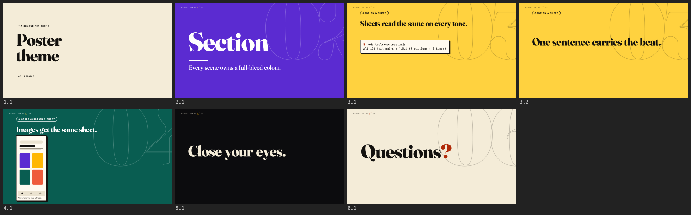
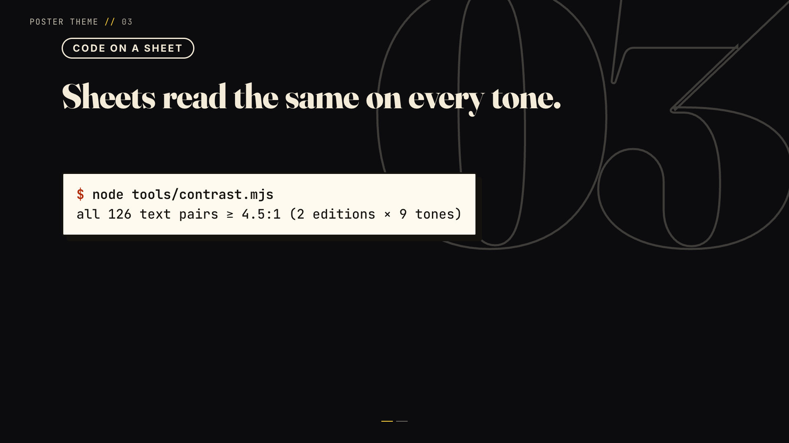

# beatdeck · Poster theme

A series of posters. Every scene owns a full-bleed colour (a **tone**), type is a high-contrast serif (Fraunces), code, terminal output and screenshots live on cream **sheets** with a hard shadow, and a giant outlined number sits behind the content. `T` flips to a **night edition**: black everywhere, the tone's colour becomes the accent.




## When to use it

- A talk told as a story: big sentences, one idea per scene, a colour that changes with the mood.
- Decks where code and screenshots are supporting evidence, not the whole content: they sit on sheets, readable on any colour.

When **not**: decks that are mostly dense code or diagrams (the sheets are small, and 9 colours compete with the content), or brands with a fixed palette (change the tones, see below).

## What is in this folder

| File | What |
|---|---|
| `poster.css` | tokens, tones, night edition, type roles, sheets, numeral, screen-reader nav styles |
| `components/poster.tsx` | `Sheet`, `Mono`, `Shot`, `BigTitle`, `Stamp`, `Say`, `ToneTheme`, `Numeral` |
| `components/a11y-kit.tsx` | optional, theme-independent: `ThemeToggle` (key T), `StagePicture`, `LiveRegion`, `SrNav` (see "Accessibility") |
| `tools/contrast.mjs` | WCAG contrast of every text token in every tone and both editions |
| `example/deck/` | a six-scene demo deck using all of it |
| `install.sh` | copies the pieces into a beatdeck project |

## Install

```bash
npx degit borjaperfra/beatdeck my-talk && cd my-talk
npm run init -- --title "My talk" --author "Me" --lang en
npm install
/path/to/beatdeck/themes/poster/install.sh . --example     # --example replaces deck/ with the demo; leave it out to keep your scenes
npm run build && node tools/contrast.mjs
```

`install.sh` adds `@fontsource-variable/fraunces` (SIL OFL, bundled: the deck stays offline) and copies the files to `themes/poster.css`, `deck/poster.tsx`, `deck/a11y-kit.tsx`, `tools/contrast.mjs`.

## Use it

In `deck/index.tsx`:

```tsx
import '../themes/neutral.css';   // fonts + base type roles (Inter, JetBrains Mono)
import '../themes/poster.css';    // after it
import { LiveRegion, SrNav, StagePicture, ThemeToggle } from './a11y-kit';
import { Numeral, ToneTheme } from './poster';
import { TONES } from './tones';

function Stage() {
  return (
    <>
      <ThemeToggle />
      <ToneTheme tones={TONES} />
      <LiveRegion summaries={SR} />
      <SrNav />
      <StagePicture>
        <Numeral hideOn={[0]} />     {/* scene indexes without a numeral */}
        <Open />  <Section /> …
      </StagePicture>
    </>
  );
}
```

`deck/tones.ts` maps scene ids to tones:

```ts
export const TONES: Record<string, string> = { '01': 'paper', '02': 'violet', '03': 'sun', '04': 'night' };
```

Scenes then use the components and the theme's type roles:

```tsx
<BigTitle on={here} title="Section" line="One line under it." />
<Say on={here} text="One sentence carries the beat." />
<Mono on={here} x={150} y={420} size={32} lines={['$ npm test', 'ok']} />   {/* a Terminal on a sheet */}
<Shot on={here} src={img} alt="What the picture shows" x={150} y={300} />       {/* alt is required */}
<Stamp on={here} text="a stamped label" />
```

## Tones

| Tone | Background | Ink | Accent | Mood |
|---|---|---|---|---|
| `paper` (default) | `#f4ecd8` | near-black | rust `#b02a08` | the calm frame of the talk |
| `night` | `#0c0c0e` | cream | amber | the dramatic beat |
| `sun` | `#ffd23f` | near-black | dark rust | statistics, claims |
| `amber` | `#ffb703` | near-black | violet | warmth |
| `coral` | `#ef5b3c` | near-black | near-black | alarm, urgency |
| `stone` | `#d9d4c7` | near-black | rust | backup, appendix |
| `violet` | `#5b2bd1` | white | yellow | sections |
| `teal` | `#095d51` | white | yellow | sections |
| `blue` | `#1d4ed8` | white | yellow | sections |

Add or change a tone in `poster.css`:

```css
:root[data-tone='mint'] { --bg: #0b6b4a; --ink: #ffffff; --ink-2: rgba(255,255,255,.88); --ink-3: rgba(255,255,255,.8); --hair: rgba(255,255,255,.3); --hair-strong: rgba(255,255,255,.5); --accent: #ffd23f; }
:root[data-theme='dark'][data-tone='mint'] { --accent: #7be0b1; }
```

Light-ink tones must restate the ink tokens; dark-ink tones only need `--bg` and `--accent`. **Then run `node tools/contrast.mjs`**: it cascades the rules the way the browser does and fails on any text pair under 4.5:1 (WCAG AA) in either edition.

## Gotchas (each one cost time once)

- **Fraunces draws the digit `1` like a lowercase `l`.** "a11y" reads "ally", "2001" reads "200l". Set such words in the sans: `<span className="sans-word">a11y</span>`.
- **Tracking.** Fraunces at display size wants `letter-spacing` around −0.02em; tighter and words run together (the theme sets −0.018em plus a little word-spacing).
- **Sheets restyle their children.** `.sheet` redefines `--ink`, `--accent` and `--bg` so a `Terminal` inside reads the sheet's colours, not the tone's. Do not put tone-coloured text on a sheet.
- **Persona/semantic colours on a tone.** Text colours must be chosen per tone: a colour that passes on paper fails on coral. The only guarantee is the contrast script.
- **The numeral is decoration.** Render it inside `<StagePicture>` (hidden from assistive tech) and hide it on scenes where it collides with content (`hideOn`).
- **A mid-transition tone.** The stage background transitions in 400 ms (beatdeck's own `.stage` rule); screenshots taken mid-fade look washed out. `npm run shot` / `verify` wait for it.

## Accessibility

The theme itself: AA contrast for every text token in every tone and both editions, `prefers-reduced-motion` honoured by the engine, no information carried by colour alone.

`components/a11y-kit.tsx` exists because of how beatdeck renders: **every scene layer stays mounted and the inactive ones are hidden with `opacity`, which hides nothing from assistive technology.** A screen reader on the raw deck reads every scene at once, and nothing can be focused, so a keyboard- or switch-only visitor cannot advance. The kit hides the stage's pictures (`StagePicture`), announces each beat from a text equivalent you write (`LiveRegion` + a `summaries` map keyed `<scene id>.<beat name>`, never the speaker notes), and adds real Previous/Next buttons (`SrNav`). Test it: `page.locator('body').ariaSnapshot()` at a beat should contain that beat's announcement and the two buttons, and nothing from other scenes.

What it does **not** give you: a tested experience with a real screen reader (VoiceOver, NVDA). Try one before you claim your deck is accessible.

## Provenance and licence

Fonts: Fraunces, Inter, JetBrains Mono, all SIL OFL, bundled from npm at build time. The files in this folder follow the licence of the repository they are in.
